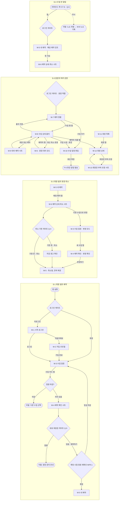

# 소형 필라테스 센터 예약 앱 — Wireframes

> 이 문서가 화면 구성의 **SSOT**다. 디자인 파일(`design_file`)은 이 문서를 그린 뷰이며, 둘이 어긋나면 이 문서를 기준으로 맞춘다.
> 저해상도(lo-fi)만 다룬다 — 회색조 박스·실제 핵심 문구·배치 순서까지. 색·폰트·토큰 값은 디자인 시스템(`DESIGN.md`) 몫이다.
> 표기: 사실이 없으면 `미확정`, 판단의 출발점은 `미확정 (제안: <값> — <근거>)` — 둘 다 §7에서 확인한다.

## 1. 범위·입력
- 기준 문서: PRD 0.1.0 · TRD 없음 — UI 기반은 PRD §7 제약(iOS·Android 모두 지원, NFR-6)으로 가정 (WQ-1)
- 대상 플랫폼·기준 뷰포트: 미확정 (제안: iOS·Android 네이티브 앱, 모바일 우선 360×800 세로 — PRD §7 "iOS와 Android 모두 지원". 원장 화면도 같은 모바일 앱 안의 원장 역할 화면으로 가정 — Q-7, WQ-2)
- 충실도: lo-fi 회색조 박스 + 실제 핵심 문구 초안. 이번 실행은 `tool=none` — 문서만 작성, 작도는 `tool=pencil` 재실행으로 이어서 한다.
- 다루는 시나리오·기능: S-1, S-2, S-3, S-4 · F-1, F-2, F-3, F-4, F-5 (화면 있음), F-6 (화면 없음 — 푸시 알림의 진입점은 W-5)
- 작도 차수 (13화면 — 기본 범위 6~12개를 넘어 시나리오 단위로 나눈다, WQ-3):
  - 1차: 회원 S-1·S-2·S-4 + 원장 S-3 일일 운영 — W-1 ~ W-9
  - 2차: 원장 기준 데이터 관리(S-3 중 일정·회원·회원권) — W-10 ~ W-13
- 다루지 않는 것:
  - 온라인 결제(F-7, FR-16) — Later 릴리스, PRD §8 Out of Scope
  - 강사 전용 화면 — 강사 앱 사용 여부 미확정(Q-7), PRD §8에서 MVP 제외 제안
  - 매출·정산 통계, 쿠폰·마케팅 화면 — PRD §8 Out of Scope 제안
  - 앱 내 알림함 목록 — 대응 FR 없음(FR-13·14는 발송만 요구). 필요하면 PRD 갱신 (WQ-7)
  - 설정·로그아웃·회원 탈퇴 — 대응 FR 없음. 단 탈퇴 시 건강 특이사항 파기(NFR-4 제안)가 확정되면 화면이 필요해진다 (WQ-7)
  - 기존 엑셀 데이터 이관 화면 — Q-11 미확정

## 2. 화면 인벤토리
| ID | 화면 | 목적 (한 줄) | 진입 경로 | 관련 F-n · FR | 시나리오 | 프레임 |
|---|---|---|---|---|---|---|
| W-1 | 시작·로그인 | 센터 회원/원장이 앱에 들어온다 | 앱 실행(미로그인) | F-1 (FR-1) | S-1, S-3 | `W-1 시작·로그인` |
| W-2 | 회원 가입·프로필 등록 | 처음 온 회원이 연락처·건강 특이사항을 등록한다 | W-1 "처음이에요" | F-1 (FR-1) | S-1 | `W-2 회원 가입·프로필 등록` |
| W-3 | 수업 일정 (회원 홈) | 날짜별 수업과 남은 자리를 보고 예약할 수업을 고른다 | 로그인 후 회원 홈 · W-6 "다른 수업으로 변경"(변경 모드) | F-3 (FR-4) | S-1, S-2 | `W-3 수업 일정` |
| W-4 | 예약 확인 시트 | 고른 수업·차감 회원권·취소 기한을 확인하고 확정한다 | W-3 수업 카드 탭 (부모 W-3) | F-3 (FR-5, FR-7, FR-15), F-4 (FR-11) | S-1, S-2 | `W-4 예약 확인 시트` |
| W-5 | 내 예약 | 예정·지난 수업과 회원권 잔여 횟수를 확인한다 | 하단 탭 "내 예약" · 리마인드/상태 변화 푸시 탭(F-6) | F-3 (FR-7, FR-6), F-6 (FR-13, FR-14 진입점) | S-1, S-2, S-4 | `W-5 내 예약` |
| W-6 | 예약 상세·취소 시트 | 예정 예약 하나를 취소하거나 다른 수업으로 바꾼다 | W-5 예정 예약 탭 (부모 W-5) · W-8 예약자 행 "대신 취소·변경"(원장 대리 모드) | F-3 (FR-6, FR-15), F-4 (FR-11), F-5 (FR-9) | S-2, S-4, S-3 | `W-6 예약 상세·취소 시트` |
| W-7 | 예약 현황 (원장 홈) | 오늘·이번 주 수업별 예약 인원과 빈 자리를 한 번에 본다 | 로그인 후 원장 홈 | F-5 (FR-8) | S-3 | `W-7 예약 현황` |
| W-8 | 수업 상세·출석 | 한 수업의 예약자를 보고 출석·노쇼를 기록한다 | W-7 수업 행 탭 | F-5 (FR-8, FR-12, FR-9 진입), F-4 (FR-11) | S-3 | `W-8 수업 상세·출석` |
| W-9 | 대리 예약 시트 | 전화·현장 요청 회원을 골라 대신 예약한다 | W-8 "회원 대신 예약" (부모 W-8) | F-5 (FR-9, FR-15) | S-3 | `W-9 대리 예약 시트` |
| W-10 | 수업 일정 편집 | 수업(강사·시간·정원)을 등록·수정하고 휴강 처리한다 | W-7 "+ 수업 추가" · W-8 "수업 수정" | F-2 (FR-3), F-6 (FR-14 휴강 알림 계기) | S-3 | `W-10 수업 일정 편집` |
| W-11 | 회원 목록 | 회원을 찾아 상세로 들어간다 | 원장 하단 탭 "회원" | F-1 (FR-2) | S-3 | `W-11 회원 목록` |
| W-12 | 회원 상세 | 회원 정보·건강 특이사항·회원권 잔여와 변동 이력을 본다 | W-11 회원 행 탭 · W-8 예약자 이름 탭 | F-1 (FR-2), F-4 (FR-10, FR-11) | S-3 | `W-12 회원 상세` |
| W-13 | 회원권 부여·조정 시트 | 회원권을 새로 주거나 잔여 횟수를 사유와 함께 조정한다 | W-12 "회원권 부여·조정" (부모 W-12) | F-4 (FR-10, FR-11) | S-3 | `W-13 회원권 부여·조정 시트` |

- 화면 없음: F-6 예약 알림 — 푸시 발송 기능이며 진입점은 W-5(알림 권한 안내는 W-3 첫 진입 상태). F-7 — Later.

## 3. 핵심 흐름
> PRD 시나리오(S-n)마다 화면 이동과 분기·이탈 지점을 그린다. 게이트(로그인·결제·권한·잠금)는 노드로 드러낸다.

## 4. 화면별 명세

### W-1 시작·로그인
- **우선순위 블록** (위→아래): 1) 센터 이름·로고 자리 — "OO필라테스 예약" (센터명은 Q-1에 따라 고정/선택) 2) 로그인 입력 — 로그인 방식 미확정(TRD), 문구 초안 "휴대폰 번호로 로그인" 3) 보조 링크 "처음이에요 — 회원 등록하기"
- **주요 동작:** 로그인 · 보조: 회원 등록으로 이동
- **상태:** 기본 · 로딩(로그인 처리 중 버튼 잠금) · 빈: 해당 없음 · 오류("등록된 회원 정보를 찾을 수 없어요. 센터에 등록된 번호인지 확인해 주세요") · 역할 분기: 원장 계정이면 W-7로, 회원이면 W-3으로
- **검증할 제약:** NFR-6 — iOS·Android에서 같은 구성. Q-1 — 단일 센터 앱이면 센터 선택 블록이 없고, 다중 센터 서비스면 센터 선택 블록이 1번 위로 추가된다
- **열린 질문:** Q-1, WQ-2, WQ-4

### W-2 회원 가입·프로필 등록
- **우선순위 블록** (위→아래): 1) 제목 "회원 정보를 등록해 주세요" 2) 이름·연락처 입력 3) 건강 특이사항 — 별도 동의 블록 "수업 안전을 위해 원장님만 볼 수 있어요. 허리·무릎 통증, 수술 이력 등을 적어 주세요(선택)" + 동의 체크 4) 알림 수신 안내 "수업 전에 알림으로 알려 드려요" 5) 하단 고정 버튼 "등록하고 시작하기"
- **주요 동작:** 등록하고 시작하기 · 보조: 건강 특이사항 건너뛰기
- **상태:** 기본 · 로딩(제출 중) · 빈: 해당 없음 · 오류(필수 입력 누락 필드 표시, "이미 등록된 연락처예요 — 로그인해 주세요") · 동의 게이트: 건강 특이사항 입력 시 동의 체크 필수(NFR-4 제안, Q-9)
- **검증할 제약:** NFR-4 — 건강 특이사항 블록에 "원장님만 볼 수 있어요" 노출 범위 문구가 입력란 위에 보인다. 360×800에서 "등록하고 시작하기"가 키보드에 가려지지 않는다
- **열린 질문:** Q-9, Q-1(가입 시 센터 연결 방식), Q-11(기존 회원 이관 시 가입 대신 본인 확인)

### W-3 수업 일정 (회원 홈)
- **우선순위 블록** (위→아래): 1) 회원권 잔여 요약 한 줄 "10회권 · 7회 남음 · 12월 31일까지" 2) 날짜 선택 줄(이번 주 7일) 3) 수업 카드 목록 — "오전 10:00 · 매트 그룹 · 김하나 강사 · 남은 자리 2/6", 마감 카드 "마감" 4) 하단 탭(수업 일정 / 내 예약)
- **주요 동작:** 수업 카드 탭 → W-4 · 보조: 날짜 이동
- **상태:** 기본 · 로딩(카드 자리 회색 박스) · 빈("이 날은 열린 수업이 없어요") · 오류("일정을 불러오지 못했어요 · 다시 시도") · 변경 모드(상단 배너 "변경할 수업을 골라 주세요 — 기존: 11/5 오전 10:00", 기존 수업 카드 표시) · 첫 진입 알림 권한 안내("수업 전에 알려 드릴까요?") · 회원권 없음(1번 블록이 "사용할 수 있는 회원권이 없어요 — 센터에 문의해 주세요")
- **검증할 제약:** NFR-3 — 앱 진입부터 예약 확정까지 3단계 이내(W-3 카드 탭 → W-4 예약하기 = 2탭). 첫 화면에 남은 자리가 카드마다 보인다(FR-4). 마감·휴강 카드가 예약 가능 카드와 구분된다
- **열린 질문:** Q-2(1:1·기구 레슨이면 카드 구성이 달라짐), Q-5

### W-4 예약 확인 시트
- **우선순위 블록** (위→아래): 1) 수업 요약 "11월 5일(수) 오전 10:00 · 매트 그룹 · 김하나 강사" 2) 차감 안내 "10회권에서 1회 차감돼요 · 예약 후 6회 남음" 3) 취소 기한 안내 "11월 4일(화) 오전 10:00까지 무료 취소할 수 있어요" (Q-4 제안값 기준 문구) 4) 하단 버튼 "예약하기"
- **주요 동작:** 예약하기 · 보조: 닫기
- **상태:** 기본 · 로딩(확정 처리 중 버튼 잠금 — 중복 탭 방지) · 빈: 해당 없음 · 오류("방금 자리가 모두 찼어요. 다른 수업을 골라 주세요" — 동시 예약 경합, NFR-1 / "이미 예약한 수업이에요") · 회원권 게이트(유효 회원권 없음 → 버튼 비활성 + "사용할 수 있는 회원권이 없어요", Q-5) · 변경 모드(1번이 "11/5 오전 10:00 → 11/6 오후 7:00", 버튼 "변경하기") · 완료(시트 닫힘 + "예약됐어요" 토스트 → W-5)
- **검증할 제약:** NFR-3 — 시트 하나에서 확인·확정(추가 화면 없음). FR-7 — 확정 전 잔여 횟수 변화가 보인다. 3번 취소 기한 문구가 버튼 위에 있어 확정 전에 읽힌다
- **열린 질문:** Q-4, Q-5, Q-8, WQ-5

### W-5 내 예약
- **우선순위 블록** (위→아래): 1) 회원권 카드 "10회권 · 6회 남음 · 12월 31일까지" 2) 다가오는 수업 목록 — 가장 가까운 수업 먼저 "내일 오전 10:00 · 매트 그룹 · 김하나 강사" 3) 지난 수업 목록 — "11월 1일 · 출석" / "10월 29일 · 노쇼 · 1회 차감" / "10월 27일 · 취소"
- **주요 동작:** 예정 예약 탭 → W-6 · 보조: 지난 수업 더 보기
- **상태:** 기본 · 로딩 · 빈("예정된 수업이 없어요 — 수업 일정에서 예약해 보세요" + W-3 이동) · 오류(불러오기 실패 · 다시 시도) · 푸시 진입(해당 예약 카드 강조, S-4) · 휴강 통지(해당 예약에 "휴강 — 1회 복원됐어요", FR-14)
- **검증할 제약:** FR-7 — 회원권 잔여와 예정 수업이 첫 화면에 함께 보인다. S-4 — 푸시로 들어왔을 때 해당 예약이 스크롤 없이 보인다. NFR-2 — 지난 수업의 차감·복원 사유가 항목에 표시된다
- **열린 질문:** Q-4, Q-6

### W-6 예약 상세·취소 시트
- **우선순위 블록** (위→아래): 1) 수업 요약 "11월 5일(수) 오전 10:00 · 매트 그룹 · 김하나 강사" 2) 취소 정책 상태 — 기한 전 "지금 취소하면 횟수가 돌아와요" / 기한 후 "수업 24시간 전이 지나 취소해도 1회 차감돼요" (Q-4 제안값 기준) 3) 버튼 "예약 취소" 4) 보조 링크 "다른 수업으로 변경"
- **주요 동작:** 예약 취소 · 보조: 다른 수업으로 변경(→ W-3 변경 모드)
- **상태:** 기본 · 로딩(처리 중) · 빈: 해당 없음 · 오류("취소하지 못했어요 · 다시 시도") · 취소 기한 후(2번 차감 경고 + 확인 단계 "그래도 취소할게요") · 수업 시작 후(취소 버튼 없음, "이미 시작된 수업이에요") · 원장 대리 모드(상단 "OOO 회원 대신 처리", 기한 후 차감 면제 여부는 WQ-6)
- **검증할 제약:** S-2 — 취소 전 차감 여부가 버튼보다 먼저 보인다. 주요 동작이 하나여야 한다 — 취소와 변경이 같은 시트에 있어 시나리오 분기 신호(§6 V-5)
- **열린 질문:** Q-4, WQ-5, WQ-6

### W-7 예약 현황 (원장 홈)
- **우선순위 블록** (위→아래): 1) 기간 전환 "오늘 / 이번 주" 2) 오늘 요약 "오늘 수업 5개 · 예약 23명 · 빈 자리 7" 3) 수업 행 목록 — "오전 10:00 · 매트 그룹 · 김하나 · 6/6 마감" / "오후 7:00 · 기구 · 박둘 · 4/6" (휴강 행은 "휴강") 4) "+ 수업 추가" 5) 하단 탭(현황 / 회원)
- **주요 동작:** 수업 행 탭 → W-8 · 보조: 수업 추가(→ W-10), 기간 전환
- **상태:** 기본 · 로딩 · 빈("오늘은 수업이 없어요 · 수업 추가") · 오류(불러오기 실패 · 다시 시도)
- **검증할 제약:** FR-8 — 오늘 수업 전체의 예약 인원·빈 자리가 360×800에서 한 화면에 들어간다(하루 수업 수 상한은 미확정 — §6 V-7). 이번 주 보기에서 날짜별 묶음이 구분된다
- **열린 질문:** Q-7(원장 기기 — PC면 레이아웃 재설계), WQ-2

### W-8 수업 상세·출석
- **우선순위 블록** (위→아래): 1) 수업 요약 "11월 5일 오전 10:00 · 매트 그룹 · 김하나 강사 · 6/6" 2) 예약자 목록 — 행마다 "이지은 · 10회권 3회 남음 · 건강 특이사항 있음" + 출석/노쇼 선택 3) "회원 대신 예약" 4) "수업 수정" 5) 하단 고정 버튼 "출석 저장"
- **주요 동작:** 출석 저장 · 보조: 회원 대신 예약(→ W-9), 예약자 행 메뉴 "대신 취소·변경"(→ W-6 원장 대리 모드), 수업 수정(→ W-10)
- **상태:** 기본 · 로딩 · 빈("아직 예약한 회원이 없어요" + 회원 대신 예약) · 오류(저장 실패 — 선택값 유지 + 다시 시도) · 수업 전(출석 선택 비활성, "수업 시작 후 기록할 수 있어요") · 저장 완료(행에 "출석 · 1회 차감" / "노쇼 · 1회 차감" 반영) · 휴강된 수업(예약자 목록 대신 "휴강 — 예약 n건 취소·복원됨")
- **검증할 제약:** NFR-4 — 건강 특이사항은 원장 화면에서만 "있음" 표시, 내용은 W-12에서 확인. 정원 6명 기준 예약자 전원 + "출석 저장"이 스크롤 없이 보인다. 행별 출석/노쇼 터치 영역이 서로 붙지 않는다
- **열린 질문:** Q-4(출석·노쇼 차감 시점), Q-7(강사 기록 여부), WQ-6

### W-9 대리 예약 시트
- **우선순위 블록** (위→아래): 1) 대상 수업 "11월 5일 오전 10:00 · 매트 그룹 · 남은 자리 2" 2) 회원 검색 "이름 또는 전화번호 뒷자리" 3) 검색 결과 — "이지은 · 010-****-1234 · 10회권 3회 남음" 4) 하단 버튼 "이 회원으로 예약"
- **주요 동작:** 이 회원으로 예약 · 보조: 닫기
- **상태:** 기본 · 로딩(검색 중 / 확정 중) · 빈("찾는 회원이 없어요 — 회원 등록은 회원 탭에서") · 오류(정원 마감·중복 예약 — W-4와 같은 문구) · 회원권 게이트(선택 회원 회원권 없음 → "회원권을 먼저 부여해 주세요" + W-13 이동, Q-5)
- **검증할 제약:** FR-15 — 처리 주체가 "원장 대리"로 남는다는 표시가 시트에 있다("원장님 이름으로 기록돼요"). 원장 대리 예약은 3단계 이내(검색 → 선택 → 예약)
- **열린 질문:** Q-5, WQ-4(원장이 회원 등록을 대신 하는가)

### W-10 수업 일정 편집
- **우선순위 블록** (위→아래): 1) 제목 "수업 추가" / "수업 수정" 2) 날짜·시작 시간·소요 시간 3) 강사 선택 4) 정원 "6명" 5) 반복 여부(미확정 — WQ-8) 6) 하단 버튼 "저장" 7) 수정 시 하단 텍스트 링크 "이 수업 휴강하기"
- **주요 동작:** 저장 · 보조: 휴강하기(확인 단계 "예약한 4명에게 휴강 알림을 보내고 횟수를 돌려드려요. 휴강할까요?")
- **상태:** 기본 · 로딩(저장 중) · 빈: 해당 없음 · 오류(필수값 누락, 같은 시간 강사 중복 경고 — Q-8) · 정원 축소 충돌("이미 5명이 예약했어요. 정원을 5명보다 줄일 수 없어요", NFR-1) · 휴강 확인
- **검증할 제약:** NFR-1 — 정원을 현재 예약 수 아래로 줄이는 입력이 화면에서 막힌다. 휴강 확인 문구에 영향받는 예약 수가 보인다(F-6 FR-14 연결)
- **열린 질문:** Q-2, Q-7, Q-8, WQ-8

### W-11 회원 목록
- **우선순위 블록** (위→아래): 1) 검색 "이름 또는 전화번호" 2) 필터 칩 "전체 / 회원권 만료 임박 / 회원권 없음" 3) 회원 행 — "이지은 · 10회권 3회 남음 · 12/31까지" 4) 하단 탭(현황 / 회원)
- **주요 동작:** 회원 행 탭 → W-12 · 보조: 검색·필터
- **상태:** 기본 · 로딩 · 빈("아직 등록된 회원이 없어요" — 이관 여부 Q-11) · 검색 결과 없음 · 오류
- **검증할 제약:** 회원 행에 건강 특이사항 내용이 노출되지 않는다(NFR-4, 목록은 표시 여부도 생략)
- **열린 질문:** Q-11, WQ-4

### W-12 회원 상세
- **우선순위 블록** (위→아래): 1) 이름·연락처 "이지은 · 010-1234-5678" 2) 건강 특이사항 "허리 디스크 이력 — 굴곡 동작 주의" (원장 전용) 3) 회원권 카드 "10회권 · 3회 남음 · 12월 31일까지" 4) 회원권 변동 이력 — "11/1 출석 −1 · 자동" / "10/29 노쇼 −1 · 자동" / "10/20 부여 +10 · 원장" 5) 예정 예약 목록 6) 하단 버튼 "회원권 부여·조정"
- **주요 동작:** 회원권 부여·조정 → W-13 · 보조: 예정 예약 탭(→ W-6 원장 대리 모드)
- **상태:** 기본 · 로딩 · 빈(회원권 없음 — 3번이 "회원권이 없어요 · 부여하기", 이력 없음) · 오류 · 건강 특이사항 미동의("회원이 건강 정보 제공에 동의하지 않았어요")
- **검증할 제약:** NFR-2 — 변동 이력마다 사유·시각·처리 주체가 보인다. NFR-4 — 건강 특이사항이 원장 역할 화면에만 존재한다
- **열린 질문:** Q-5, Q-9, Q-11

### W-13 회원권 부여·조정 시트
- **우선순위 블록** (위→아래): 1) 대상 "이지은 회원" 2) 구분 전환 "새로 부여 / 잔여 조정" 3) 새로 부여: 종류 "10회권"·횟수·유효기간 / 잔여 조정: 현재 "3회" → 조정값 ± 4) 조정 사유(필수) "예: 센터 사정으로 수업 취소" 5) 하단 버튼 "저장"
- **주요 동작:** 저장 · 보조: 닫기
- **상태:** 기본 · 로딩(저장 중) · 빈: 해당 없음 · 오류(사유 누락, "잔여 횟수는 0보다 작아질 수 없어요" — NFR-2) · 저장 완료(W-12 이력 맨 위에 반영)
- **검증할 제약:** NFR-2 — 조정 사유 입력 없이 저장할 수 없고, 결과 잔여가 음수가 되는 값은 막힌다. 저장 전 "3회 → 5회" 결과가 보인다
- **열린 질문:** Q-5(기간권 등 종류), Q-11

## 5. 컴포넌트 후보
> 디자인 시스템 B-n의 범위 출처. 두 화면 이상에서 쓰이거나, 한 화면이라도 상태·변형이 셋 이상인 것만 올린다.

| 컴포넌트 | 사용 화면 | 변형·상태 | 비고 |
|---|---|---|---|
| `ClassSlotCard` | W-3, W-7 | 예약 가능 · 임박(자리 적음) · 마감 · 내가 예약함 · 휴강 · 변경 모드의 기존 수업 | 회원용(카드)·원장용(행) 밀도 차이 — 변형으로 둘지 B-n에서 결정. 기반 제공 여부는 TRD §2.1 미정 |
| `SeatAvailability` | W-3, W-4, W-7, W-8, W-9 | 여유 · 임박 · 마감 | 남은 자리 "2/6" 표기 |
| `DateStrip` | W-3, W-7 | 날짜 선택 · 오늘 · 수업 없음 날 | 원장 "오늘/이번 주" 전환과 함께 쓸지 B-n에서 결정 |
| `PassBalanceSummary` | W-3, W-4, W-5, W-9, W-11, W-12 | 정상 · 만료 임박 · 없음 · 차감 미리보기("7 → 6") | 회원권 잔여 표시의 단일 출처 (NFR-2 표기 일관) |
| `CancelPolicyNotice` | W-4, W-6 | 무료 취소 가능 · 기한 지남(차감 경고) · 수업 시작됨 | 문구는 Q-4 확정값에 종속 |
| `ReservationItem` | W-5, W-12 | 예정 · 출석 · 노쇼 · 취소 · 휴강 | 지난 수업 상태에 차감·복원 사유 표시 |
| `AttendeeRow` | W-8 | 미기록 · 출석 · 노쇼 · 건강 특이사항 있음 · 대리 처리 메뉴 | 한 화면이지만 상태 4개 이상 |
| `PassLedgerItem` | W-5, W-12 | 차감(자동) · 복원(자동) · 부여(원장) · 조정(원장, 사유) | NFR-2 변동 이력 표기 |
| `HealthNoteBlock` | W-2, W-8, W-12 | 입력(동의 포함) · 있음 표시(원장) · 내용 열람(원장) · 미동의 | NFR-4 노출 범위 — 회원 간 노출 금지 |
| `MemberSearchList` | W-9, W-11 | 검색 전 · 결과 · 결과 없음 | |
| `ActionSheet` | W-4, W-6, W-9, W-13 | 기본 · 처리 중 · 확인 단계(위험 동작) · 오류 | 하단 고정 주요 버튼 1개 규칙 |
| `StatusBlock` | 전 화면 | 로딩 · 빈 · 오류(다시 시도) | 빈·오류 문구 슬롯 |
| `RoleTabBar` | W-3, W-5 (회원) · W-7, W-11 (원장) | 회원 탭 · 원장 탭 | 단일 앱 역할 분기 가정(WQ-2)에 종속 |
| `FormField` | W-1, W-2, W-10, W-13 | 기본 · 포커스 · 오류 · 비활성 | 기반 제공 여부는 TRD §2.1 미정 |

## 6. 와이어프레임에서 확인한 것
> 그려 보고 알게 된 사실. PRD·TRD를 직접 고치지 않고 영향만 적는다.
> 이번 실행은 `tool=none` — 화면 제약은 모두 **판단 불가 — 미작도**다. `tool=pencil`로 그린 뒤 다시 판정한다. 아래 "결정 공백"은 흐름을 문서로 짜면서 드러난 것이다.

| ID | 대상 (A-n / R-n / NFR-n / Q-n) | 결과 | 영향 |
|---|---|---|---|
| V-1 | NFR-3 — 진입부터 예약 확정까지 3단계 이내 (W-3, W-4) | 판단 불가 — 미작도 (흐름상 2탭 설계) | 없음 (작도 후 판정) |
| V-2 | NFR-4 — 건강 특이사항 노출 범위 (W-2, W-8, W-11, W-12) | 판단 불가 — 미작도 | Q-9 확정 전까지 W-2 동의 블록 문구 잠정 |
| V-3 | NFR-1 — 동시 예약 경합 오류·정원 축소 차단 노출 (W-4, W-9, W-10) | 판단 불가 — 미작도 | 없음 |
| V-4 | NFR-2 — 차감·복원·조정 사유 표시, 음수 차단 (W-5, W-12, W-13) | 판단 불가 — 미작도 | 없음 |
| V-5 | W-6 주요 동작 1개 규칙 — 취소와 변경이 한 시트에 공존 | 판단 불가 — 결정 공백 | "변경"이 원자적 이동인지(새 수업 실패 시 기존 유지) 취소+재예약인지 PRD에 없음 → Q-4에 연결, F-3 FRD 착수 전 결정 필요 (WQ-5) |
| V-6 | Q-5 — 유효 회원권이 없을 때 예약 차단 게이트 위치 (W-3, W-4, W-9) | 판단 불가 — 결정 공백 | 차단이면 W-3 상단·W-4 버튼 비활성, 허용이면 "현장 결제" 안내 필요 → PRD Q-5 결정 필요 |
| V-7 | FR-8 — 오늘 수업 전체가 W-7 한 화면에 들어감 | 판단 불가 — 미작도 + 하루 수업 수 상한 미확정 | 상한이 크면 W-7을 시간대 묶음으로 재설계 |
| V-8 | Q-7 — 원장 화면 기기 | 판단 불가 — 결정 공백 | W-7 ~ W-13을 모바일로 가정. PC면 W-7·W-8·W-11 레이아웃 재설계 (2차 작도 전 결정 권장) |
| V-9 | Q-1 — 단일 센터 / 다중 센터 | 판단 불가 — 결정 공백 | 다중 센터면 W-1·W-2에 센터 선택·연결 블록 추가, W-n 1개 증가 가능 |
| V-10 | 대리 취소 시 취소 기한 후 차감 적용 여부 (W-6 원장 대리 모드) | 판단 불가 — 결정 공백 | PRD에 없음 → Q-4에 연결, F-5 FRD 착수 전 결정 (WQ-6) |
| V-11 | W-8 정원 6명 예약자 + 출석 저장이 스크롤 없이 보임 / 출석·노쇼 터치 영역 분리 | 판단 불가 — 미작도 | 정원 상한은 Q-2(수업 유형)에 종속 |

## 7. 오픈 이슈
| ID | 질문 | 막는 것 |
|---|---|---|
| WQ-1 | TRD §2.1 미정 — UI 기반(플랫폼 구현 방식·컴포넌트 기반·디자인 도구)이 없다. 이 문서는 PRD §7로 iOS·Android 모바일 앱을 가정했다 | 디자인 시스템 B-n (B-n 자체가 아직 없음 — TRD 작성 필요) |
| WQ-2 | 미확정 (제안: 회원·원장이 같은 앱을 쓰고 로그인 역할로 화면이 갈린다, 기준 뷰포트 모바일 360×800 — PRD §7 "iOS·Android 지원"과 원장 기기 미확정 Q-7 사이의 최소 가정) | F-5 FRD, 2차 작도(W-10 ~ W-13) |
| WQ-3 | 미확정 (제안: 13화면을 1차 W-1 ~ W-9 / 2차 W-10 ~ W-13로 나눠 작도·검토 — 기본 범위 6~12개 초과, 1차가 핵심 KPI·S-1/S-2/S-4를 모두 덮음) | 없음 (작도 순서) |
| WQ-4 | 로그인 방식과 회원 등록 주체 — 회원이 직접 가입하는가, 원장이 등록한 회원만 로그인하는가 (W-1 오류 문구·W-9 빈 상태가 달라짐). 로그인 수단은 TRD | F-1 FRD |
| WQ-5 | 예약 "변경"의 의미 — 미확정 (제안: 새 수업 확정에 성공할 때만 기존 예약을 취소하는 원자적 이동, 취소 기한 판정은 기존 수업 기준 — 변경 중 자리를 잃는 사고 방지) · PRD Q-4 연결 | F-3 FRD |
| WQ-6 | 원장 대리 취소 시 기한 후 차감을 면제할 수 있는가 — PRD Q-4 연결 | F-5 FRD |
| WQ-7 | PRD에 FR이 없는 화면 — 앱 내 알림함, 설정·로그아웃·탈퇴(건강 특이사항 파기 NFR-4 제안 연결)를 MVP에 넣는가 | 없음 (넣으면 PRD 갱신 → W-n 추가) |
| WQ-8 | 수업 반복 등록(매주 같은 시간) 필요 여부 — FR-3에 없음. 원장 입력 부담과 직결 | F-2 FRD |
| WQ-9 | 화면 문구의 정책 값(24시간 무료 취소·출석/노쇼 1회 차감)은 PRD Q-4 **제안값** 기준 초안이다 | F-3·F-4 FRD (Q-4 확정 시 문구 patch) |

## 8. 변경 이력
| 버전 | 날짜 | 변경 | 사유 |
|---|---|---|---|
| 0.1.0 | 2026-11-02 | 초안 작성 (`tool=none`, 미작도) | PRD v0.1.0 · TRD 없음. 비-HITL 실행 — 범위 제안을 확인 없이 적용, 확인 목록은 §7 |
